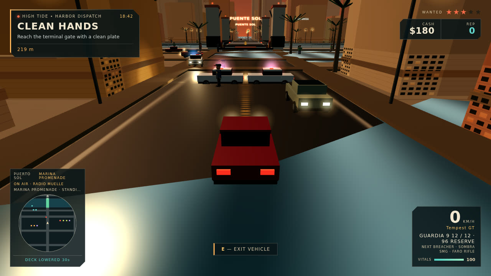
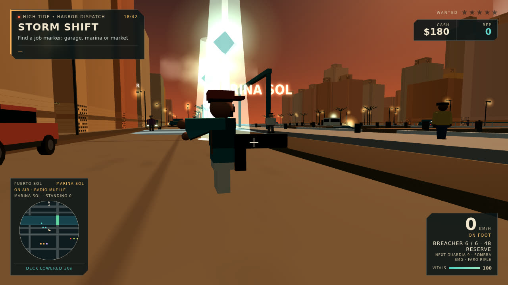
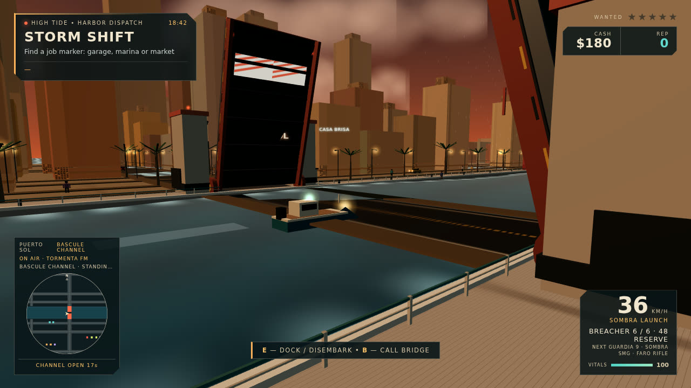
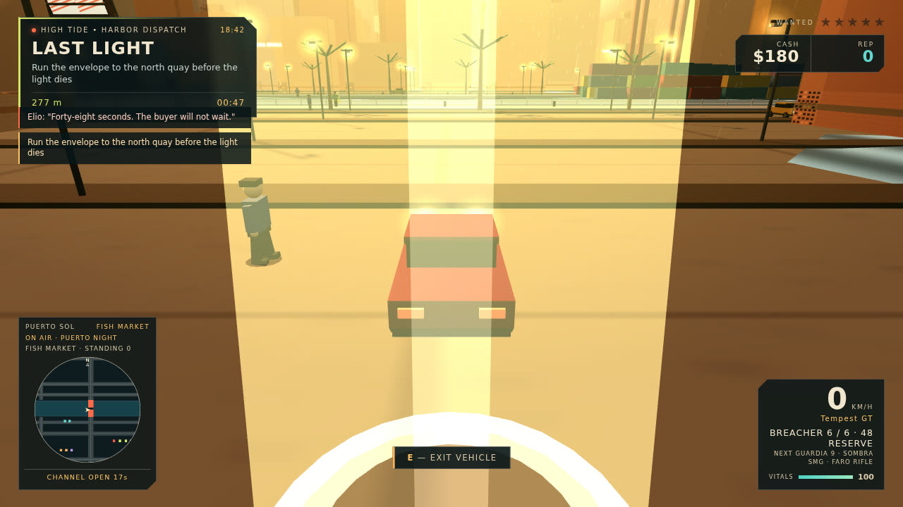

[](https://make.fun/bounty/gta6-01?utm_source=github&utm_medium=readme&utm_campaign=gta6-01)
[](https://make.fun/bounty/gta6-01/leaderboard?utm_source=github&utm_medium=readme&utm_campaign=gta6-01)
[](https://make.fun/bounty/gta6-01?utm_source=github&utm_medium=readme&utm_campaign=gta6-01)

# HIGH TIDE: STORM SHIFT

Puerto Sol, 18:42. The harbor is closing early and the storm is already on the radar.
Rico has one last shift for the Sombra crew before the water comes over the quay — and the
only way across the channel is a bascule bridge that keeps going up without asking.

A small open-world crime game in the browser: three.js, hand-built geometry, no textures
off disk, no assets to download. You get a car, a boat, four weapons, ten jobs and a wanted
level that grows every time you do something loud.



## The harbor

Puerto Sol is a grid of quays and blocks split east to west by a ship channel.
North of the water: the art-deco passenger terminal, the container yard and its gantry
cranes, the north docks. South of it: Marina Sol, the fish market, the Sombra garage, the
promenade and the clinic. Palms line the boulevards, the lamps are already lit, and the
zone name in the map card tells you where you are — MARINA SOL, FISH MARKET, NORTH DOCKS,
ART-DECO TERMINAL, SOMBRA GARAGE, BASCULE CHANNEL.

The clock in the dispatch panel starts at 18:42 and runs with the shift. The weather runs
with it too: rain thickens, the sky shader slides from sunset orange to storm grey, the fog
closes in from the horizon, the water gets choppier and the asphalt turns glossy. Past the
halfway mark, lightning cracks and thunder rolls behind it. Heat makes the storm worse.

## The bascule

The Puente Sol is the spine of the game. Two steel leaves meet over the channel at the
middle of the map, and they run on a timer whether you are in a car or in a boat:

| State | Holds for | HUD |
| --- | --- | --- |
| Deck lowered | 30 s | `DECK LOWERED 30s` (counts down) |
| Warning | 5 s | `CLEAR THE SPAN` |
| Raising | 7 s | `RAISING` |
| Channel open | 17 s | `CHANNEL OPEN 17s` (counts down) |
| Lowering | 7 s | `LOWERING` |

While the leaves are down, the channel is shut: the launch is stopped dead at the span and
has to wait. While they are up, the road is shut: lane traffic queues behind the barriers
and your car is held at the approach. The minimap paints the crossing green when it is
passable and red with a gap in it when it is not, and the pill under the map carries the
span's state — and, on the two holds, the seconds left.

You can work the bridge yourself. There is a control booth on the north quay — walk up and
press **E** to raise or lower the span. From the launch, **B** calls it. Jobs will do it for
you when the script needs the channel.

## The jobs

Ten jobs, taken from glowing markers at the garage, the marina and the market. Walk into a
marker and press **E**. The dispatch panel then carries the current step, the distance to it
and any clock, and a beacon marks the target. Each marker asks something different of you,
and when the condition is not met the panel says what is missing instead of refusing in
silence.

**DEAD DROP** — Mara, at the Sombra lot. Take the Sol Courier, load crates at the fish
market, run them to the art-deco terminal. Pays $320 and 45 REP.

**THE CROSSING** — the Sombra crew, at the marina. Board the launch, collect crate one at
the west buoy, hold west of the span while the bascule opens, take crate two east through
the raised leaves and dock at the east pier. Pays $760 and 130 REP.

**STORM RUN** — Mara again, and it only appears once DEAD DROP is done. Take the Tempest GT
out of the garage with three stars already on you and the bridge forced up: wait it out, or
run the coast road and lose the Guardia. Then deliver the black box to the north pier. Pays
$1,250 and 220 REP.

**QUAY CIRCUIT** — Elio, at the market. Five checkpoints around the south quay against a
100-second clock. Pays $420 and 70 REP.

**REPO RUN** — Mara, at the garage. A sedan lifted from the Guardia impound has to reach the
terminal weighbridge, and the job only finishes if you are still behind its wheel. Pays $380.

**LAST LIGHT** — Elio, at the market. Run an envelope to the north quay inside forty-eight
seconds. Let the clock run out and the job goes cold. Pays $460.

**CLEAN HANDS** — Mara, at the garage. The terminal gate opens only for a car with no stars
on it: lose every wanted level before you arrive. Pays $540.

**SPLIT TAKE** — the Sombra crew, at the market. Two halves of one payout: the bag behind
the fish market, then the launch at the east pier, with two stars on you from the handoff.
Pays once, at the end: $980.

**HARBOR FERRY** — Elio, at the marina. A fare will only board from open water, so the job
completes in the launch and nowhere else. Pays $520.

**TOLL RUN** — Elio, at the market. The north gate wants $200 in cash before it lifts the
barrier; arrive with the toll or not at all. Pays $430.

Jobs pay once. Cash and REP are yours to keep, and every paid job raises your standing in
the district where it finished — the map card shows the district and its standing.

## Heat

The five stars in the top right are the Guardia's interest in you. Cruisers spawn on the
road grid and come for you — up to four at a time, sirens and light bars going. Stop near
one on foot and two officers get out and start shooting. At three stars a roadblock appears
a short way down the road you are heading along: two cruisers parked across the lane and two
officers beside them, cleared when the heat drops below three. At four stars a helicopter
joins in, circling overhead with a searchlight; at five it opens fire too.

You earn heat by firing a shot, by taking a cruiser, by dropping an officer, and by running
down a civilian. You lose it by distance: stay more than a hundred metres clear for
twenty-six seconds and one star drops off. Or drive into the respray bay at the Sombra
garage and pay $180 — fresh paint, clean plates, no heat, health topped up.



## The garage, and the circuit

The Sombra garage sits on the south side with its roller door, its stripes and its sign lit
up over the lot. A Sol Courier and a Tempest GT are parked outside — the courier for the
crate work, the muscle car for when the job needs speed. The respray bay is out front.

The street race is Elio's Quay Circuit: five checkpoints around the south quay, market
straight to palm boulevard to the storm wall to the marina bridge and back, a hundred
seconds on the clock, one payout. Miss the clock and the job goes cold — you can take it
again at the marker.

## The water

The Sombra launch is moored at Marina Sol. Press **E** alongside her to board; **W** and
**S** work the throttle, **A** and **D** the helm. She tops out around 86 km/h, throws a
wake behind her, and rolls with the swell. She lives in the channel — this is a run between
the docks, not the open sea — so the bascule is the whole game: call it with **B**, wait for
the leaves, and take her through. Press **E** again alongside a quay to step off.

## The storm, and the shift

Health is 100 and it comes back on its own if nothing has hit you for eleven seconds. If it
does not, the clinic on the south side patches you up, and if you go down the clinic bill is
$120 and you wake up there with the current job failed.

Progress saves itself: every twenty-two seconds while you are playing, and whenever you
pause, get paid, get resprayed, or go down. It is kept in the browser's local storage under
`highTide.stormShift.v1`, so RESUME on the title screen picks the shift back up where you
left it — cash, REP, health, ammo, heat, clock, storm, which vehicle you were in, and which
jobs are done.



## Controls

| Input | On foot | In a car | In the launch |
| --- | --- | --- | --- |
| **W A S D** | move | throttle and steering | throttle and helm |
| **MOUSE** | camera / aim | orbit camera | orbit camera |
| **LEFT CLICK** | fire | fire | — |
| **RIGHT MOUSE** | aim | — | — |
| **SHIFT** | sprint | — | — |
| **SPACE** | — | handbrake | — |
| **E** | interact / take a job / enter a car or boat | exit | dock and step off |
| **R** | reload | — | — |
| **1 2 3 4** | select weapon | select weapon | select weapon |
| **Q** | next weapon | next weapon | next weapon |
| **T** | cycle radio station | cycle radio station | cycle radio station |
| **B** | — | — | call the bridge |
| **M** | mute | mute | mute |
| **WHEEL** | camera zoom | camera zoom | camera zoom |
| **ESC** | pause and save | pause and save | pause and save |

Four weapons, each with its own magazine and reserve: the **Guardia 9** pistol (12 rounds,
single shots), the **Breacher** shotgun (6 shells, eight pellets a pull), the **Sombra SMG**
(30 rounds, keeps firing while the trigger is held) and the **Faro Rifle** (5 rounds, long
range and slow). **1** to **4** select, **Q** cycles, **R** reloads, and the drive panel
names the gun in hand, its magazine and reserve, and the weapons still to come. The
crosshair only appears when you are actually aiming.

The radio line under the map names the station and retunes itself as you cross districts;
**T** cycles the four stations by hand.

## Running it

```
node serve.ts
```

Then open <http://localhost:8080/game/index.html>. Node 22 or newer, nothing to install.
`serve.ts` is a static file server for this directory — the game has to be served rather
than opened from disk because it loads ES modules.

There is no build step: `game/index.html` loads `game/src/main.js` directly and the browser
resolves `three` through an import map to the copy in `game/vendor/`. Once the page is up it
makes no network requests at all — no fonts, no CDNs, no telemetry. Everything the game
draws is generated at runtime: geometry, canvas textures, the sky and water shaders, the
rain, the sound (all synthesised through WebAudio, no audio files).

On a software renderer the game detects it and trims itself down — lower pixel ratio, fewer
cars and pedestrians, no shadows.



## What is in here

```
README.md            this file
game/index.html      the page, HUD markup, import map
game/style.css       the whole HUD and the title, pause and dead screens
game/src/            15 modules: world, bridge, vehicles, boat, people, police,
                     missions, hud, input, audio, save, config, utils, game, main
game/vendor/         three.js (MIT), vendored so nothing is fetched at runtime
screenshots/         four captures from the build above
main.ts              packages game/ and screenshots/ into a dossier
serve.ts             the static server above
```

MIT licensed — see [LICENSE](LICENSE).
<!-- provenance: witnessed in the high-tide session -->
